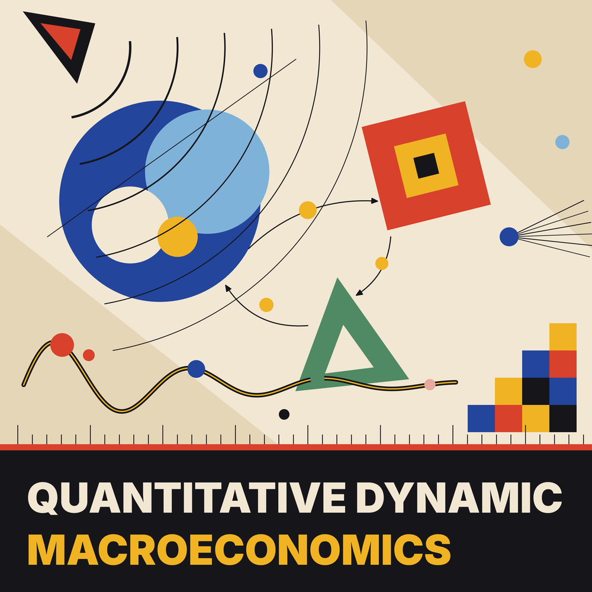

<p align="center">
  
</p>

# Quantitative Dynamic Macroeconomics

Lecture slides, problem sets, Matlab/Dynare code and a term-paper project for an
advanced undergraduate (third-year BSc) course on **quantitative dynamic macroeconomics**.
The course bridges the gap between bachelor-level IS-LM / AS-AD macroeconomics and
master/PhD-level dynamic macroeconomics: students build a dynamic stochastic general
equilibrium (DSGE) model step by step, solve it, simulate it, and finally use it for a
policy-analysis term paper.

The material has been taught several times; the structure and content are tested.

## Credit: Harold L. Cole

This course is based on the textbook and the teaching material of **Harold L. Cole**, which he
generously offered to the author:

> Cole, Harold L. (2020). *Monetary and Fiscal Policy through a DSGE Lens.* Oxford University Press.

The modelling approach and parts of the slides, problem sets and code adapt his work; sections and
code headers that do so are marked with a reference to Cole (2020). All credit for the original material
belongs to him. The adaptations, extensions and any errors are the author's, and the adaptation does not
imply his endorsement.

## Course outline

| Folder | Topic | Contents |
|---|---|---|
| `Week_1_Introduction_to_Modern_Macroeconomics` | Introduction to modern macroeconomics | lecture, data and figure script, assignment 00 (formative, intertemporal approach) and assignment 01 (three-period cash-in-advance model) |
| `Week_2_Dynamic_Macroeconomic_Models` | A dynamic cash-in-advance (CiA) economy | lecture, assignment 02 (with interpretation guide) |
| `Week_3_Random_Shocks_and_Expectations_in_Dynamic_Models` | Shocks and the statistical model (Markov chains, AR(1)) | lecture, assignment 03, handouts (growth vs. trend, Markov-kappa model) |
| `Week_4_Price_Setting_and_Timing_Assumptions` | Monopolistic competition, surprise money and aggregate demand | lecture, assignment 04 |
| `Week_5_Capital_Accumulation_and_Fiscal_Policy` | Capital and taxes in the CiA model | lecture, assignment 05 |
| `Week_6_Solving_DSGE_Models_with_Perturbation` | Perturbation and the method of undetermined coefficients | lecture, assignment 06 (with a Dynare RBC/CiA model) |
| `Week_7_New_Keynesian_Business_Cycle_Model` | New Keynesian model with Rotemberg price adjustment costs, Taylor rule | lecture, Dynare code, assignment 07 |
| `Week_8_Discussion` | Discussion workshop: Clarida, Galí and Gertler (1999) | slides, paper summary |
| `Week_7-14_Project_Policy_Analysis_with_Dynare` | Term paper (weeks 7-14): policy analysis with a New Keynesian model in Dynare | project instructions, baseline model handout, student and solution Dynare code, assessment form |

Every week folder is organised the same way:

```
Week_N_<topic>/
  lecture_0N_QDM/latex/    slides (LaTeX beamer, Metropolis theme) and figures
  lecture_0N_QDM/matlab/   code shown in the lecture
  lecture_0N_QDM/python/   Python scripts that generate figures (where applicable)
  assignment_0N_QDM/       problem set (LaTeX) and, where applicable, Matlab/Dynare files
```

## Requirements

* **LaTeX** (TeX Live or MiKTeX) with `latexmk`, the beamer *Metropolis* theme and `epstopdf`
  (all part of a standard TeX Live installation).
* **Matlab** for the `.m` files.
* **Dynare** (5.x or newer) for the `.dyn` files; Dynare must be on the Matlab path.
* **Python 3** with NumPy and Matplotlib for the figure scripts in `python/` folders (optional).

## Building the PDFs

Compiled PDFs are not stored in the repository. Build a document from its `latex` folder:

```bash
cd Week_1_Introduction_to_Modern_Macroeconomics/lecture_01_QDM/latex
latexmk -pdf -shell-escape lecture_01_QDM.tex      # -shell-escape converts the EPS figures
latexmk -c                                         # remove auxiliary files again
```

All lecture decks are compiled in beamer `handout` mode (one page per slide, no overlays),
which is convenient for reading on a laptop. Remove `handout` from the `\documentclass`
options to get the step-by-step overlays for presenting.

## Assignments and solutions

The assignment sources (`assignment_0N_QDM.tex`) use the `exercise` package. All assignments
compile with worked answers by default; load the package with the `noanswer` option to
hide them:

```latex
\usepackage{exercise}              % exercises with worked answers (default)
\usepackage[noanswer]{exercise}    % exercises only
```

Matlab solution files are named `assignment_NN_solution.m`; student templates `assignment_NN_student.m`
(where a template exists). Assignments 05, 06 (apart from its Dynare file) and 07 come without Matlab code.

## Project models (Dynare)

`Week_7-14_Project_Policy_Analysis_with_Dynare/` contains two versions of the New Keynesian model:

* `dynare_student/`: the baseline model that the project handout describes (monetary shocks and a
  TFP shock, passive fiscal policy, taxes close to zero at 1e-5).
* `dynare_solution/`: the same model plus extensions. It adds four scenario shocks (cost-push,
  investment-specific, money velocity, COVID labor wedge) and an optional **fiscal block**
  (government spending, public liabilities, a lump-sum tax rule, tax and public-debt shocks). Set
  `fiscal = 1` in `run_nk_model.m` to switch the block on; this is passed to Dynare as the macro
  variable `fiscal` and also controls the steady-state file. With `fiscal = 0` (default) the model
  reduces to the baseline plus the scenario shocks. The extension is a worked example and does not
  solve the five project topics.

Both versions use the same calibration (student values) for all common parameters; with `fiscal = 1`
the taxes (0.2), the debt target and the fiscal rule parameters take their fiscal-example values.
In all shock processes a positive innovation raises the shock process.

## Running the Matlab / Dynare code

Run the scripts from their own folder. Dynare writes its output (`+<model>/`,
`<model>/Output/`, logs, result files) next to the `.dyn` file; these files are listed in
`.gitignore` and can be deleted at any time.

## Data

`Week_1_.../lecture_01_QDM/data/` contains one frozen file, `data.xlsx`, with the quarterly U.S.
macroeconomic series (FRED, Federal Reserve Bank of St. Louis, <https://fred.stlouisfed.org>) used in the
first lecture. `data/README.md` lists the series, FRED IDs and units; `data_figures.m` reads the file,
computes the moments on the slides and exports the lecture figures.

## Figure scripts

The figures that are not drawn in LaTeX are generated by scripts, so they can be rebuilt:

| Figures | Script |
|---|---|
| Lecture 1 (`gdp_growth`, `gdp_cycle`, `phillips_us`, `infl_exp`, `infl_interest`) | `lecture_01_QDM/data/data_figures.m` |
| Lecture 3 (`rand1-4`, AR(1) examples) | `lecture_03_QDM/python/ar1_examples.py` |
| Lecture 4 (`irf`, `simulation`) | `lecture_04_QDM/matlab/lecture_04_QDM.m` |
| Lecture 5 (tax-revenue plots) | `lecture_05_QDM/matlab/tax_revenue_bgp.m` |
| Lecture 6 (`taylor_approx_order`) | `lecture_06_QDM/python/taylor_approx_order.py` |
| Lecture 7 (`irfs_with_capital`, `irfs_without_capital`) | `lecture_07_QDM/dynare/run_nk_model.m` |

## License

* Code (`.m`, `.dyn`, `.py`): MIT License, see [`LICENSE`](LICENSE).
* Slides, handouts, problem sets and other teaching material: Creative Commons
  Attribution-NonCommercial-ShareAlike 4.0 International, see
  [`LICENSE-MATERIALS.md`](LICENSE-MATERIALS.md).
* Third-party material remains subject to its original terms and is not covered by the licenses
  above: the figures reproduced on the slides with a source line (The Economist, BBC, Federal
  Reserve Banks, Tax Foundation, Christiano, Eichenbaum and Evans (2005)) and the FRED /
  University of Michigan data.

## Acknowledgements

Harold L. Cole (see above) for the textbook and the teaching material this course is based on. The
Matlab files `lecture_03_QDM.m`, `assignment_03_solution.m`, `assignment_03_student.m`, `lecture_04_QDM.m`, `lecture_06_QDM.m` and
`markov_kappa_model.m` are adapted from code accompanying Cole (2020); see their headers. The interpretation guide in
`assignment_02_QDM` is based on a note by Tulio Bouzas.

## How to cite

See [`CITATION.cff`](CITATION.cff).

## Author

Konstantin Gantert

ORCID: [0000-0001-9669-4585](https://orcid.org/0000-0001-9669-4585) | Website: [www.kgantert.de](https://www.kgantert.de)
